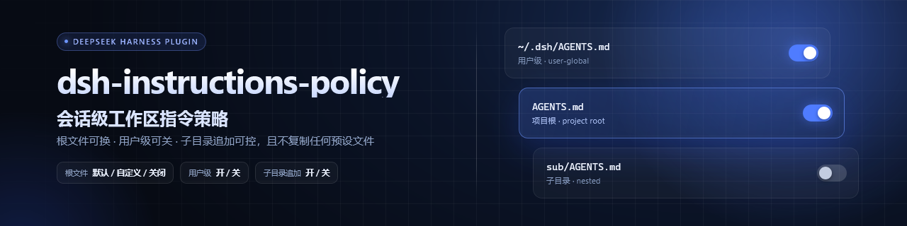
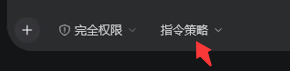

<div align="center">


# dsh-instructions-policy


[](https://www.npmjs.com/package/dsh-instructions-policy)

[简体中文](README.md) · **English**

</div>

---

Session-scoped policy for **DeepSeek Harness (DSH)** workspace instructions: choose the root `AGENTS.md`, switch user-global instructions off, switch subdirectory discovery off — without copying a single preset file.

## When you need it

DSH hard-codes three instruction behaviours: it reads the **project root**'s `AGENTS.md`/`CLAUDE.md`, it reads the **user-global** `~/.dsh/AGENTS.md` and `~/.agents/AGENTS.md`, and it **appends** a directory's `AGENTS.md` after that directory is read. DSH exposes no per-session switch for any of this, and developers (like me) frequently need full control while working with an AI assistant. The usual workaround is to edit a preset — which means copying the whole `config.plugins` list and drifting on every DSH upgrade. This plugin does two things instead:

1. **It leaves presets alone**: the shipped instruction loader is replaced wholesale at the Loader's module import seam, so official presets keep upgrading as usual;
2. **It makes the policy session state**: both `/instructions` and the Web chip change it, and the policy is replayed only from events already declared in the session log, so resume, compaction, and fork never lose it.

*Note: "project root" follows the official mechanism — the first directory containing `.git` when walking up from the working directory, or the working directory itself when none is found.*

## How it works

<details>
<summary>Expand the mechanism tree</summary>

```text
profile boot
└─ cordis.patch.yml inserts the host row `instructions-policy`
   ├─ src/index.ts: wraps loader.internal.import into an accessor + Proxy (only `import` is overridden)
   │  └─ any preset importing @deepseek-ai/dsh-agent-instructions
   │     ├─ ① first imports the running shipped module with the original import → reuses the renderer
   │     │      (so the prompt format always matches the installed DSH)
   │     └─ ② hands this package's lib/loader.js to the Loader (facade merges host row + preset row config)
   │        └─ every agent/pre-step (before the next step starts)
   │           ├─ folds the session log surface.nodes → which instructions the model currently sees
   │           ├─ replays command/run + command/done → this session's policy
   │           ├─ discovers files: project root → cwd chain + user-global + already-touched subdirectories
   │           ├─ renders: shipped renderer first, built-in fallback; reports omitted/truncated as rendered
   │           └─ injects the agent-instructions message (with changes / policy)
   │              ├─ compaction changes the surface → baseline is rebuilt on the next step;
   │              │  nested waits until the matching directory is touched again
   │              └─ after resume it recovers from the log → nothing is injected twice
   └─ registers the `instructionsPolicy` session projection
      └─ the Web chip reads policy/lock/last error/project root/loaded files through useProjection
         └─ writes go through remote.commands.execute, which returns the handler result directly
```

Because this uses the import seam every preset passes through, Standard / PTC / Creator and any other preset pick the policy up with no edits. Each step only sends a baseline when its identity changed or a nested addition appeared, so nothing is injected twice.

</details>

## Alignment and constraints

The project stays as close to the official plugin model as possible; the table below records the alignment and this project's own constraints.

<details>
<summary>Expand the conventions table</summary>

| Upstream convention | How this project complies |
|---|---|
| Official extension points only; the agent loop is untouched | `agent/pre-step`, `tools/result`, the command service, client slots |
| Model-visible ⟺ in the session log | both instruction text and policy are rebuilt from the session log |
| Prefer capabilities of the running version | reuses the installed version's instruction renderer |

**Following `agent-instructions`**: budgets, truncation, escaping, and `changes` record only what was actually rendered. Those are that package's behaviour, not a generic plugin rule.

**This project's own constraints**: zero runtime dependencies; no preset or shipped loader is copied.

</details>

## Usage

### Commands

```text
/instructions                    show the current policy, project root, and the files actually loaded
                                 (appended subdirectory files included; budget exclusions listed separately)
/instructions root default       restore reading the project root
/instructions root off           skip the project-root layer (cwd and intermediate directories still load)
/instructions root custom <path> replace the project-root layer with one file
                                 (a relative path resolves against cwd first, then the project root)
/instructions global on|off      switch user-global instructions on or off
/instructions nested on|off      switch subdirectory appends on or off (effective next step)
```

Subdirectory appends fire only when the `file_path` of a `read`/`write`/`edit` call lands inside the working-directory subtree (same as upstream); `cd` or a directory listing in a shell does not count.

The `files:` line of `/instructions show` lists the baseline files the renderer actually carries, plus any nested files already appended in the log. Baseline files dropped by the budget appear under `not loaded (budget):`; with `maxBytes: 0` it prints `budget: disabled` instead.

### Web chip

An "Instruction policy" menu appears to the left of the composer (next to the permission control). Hovering it shows the resolved project root, the files currently loaded, and both switches. A custom root can be picked from the workspace browser, or uploaded from this machine as a `.md`/`.markdown`/`.txt` file.



## Install

### Prerequisites

- DSH is installed and has been started at least once (`dsh --version` prints a version).
- Node.js follows DSH: 0.2.2 requires ≥ 24.9, 0.2.1 requires `^22.19.0 || >=24.0.0`; defer to DSH's `engines`.
- `pnpm` is on `PATH`: `dsh plugin` forwards its arguments to pnpm in the profile directory.
- DSH `>=0.2.1-rc.5 <1.0.0-0` (all 0.x releases are admitted; 1.0 and its prereleases need re-validation).

### Steps

1. Install the plugin into a profile (`web` is the default Web profile name):

   ```sh
   # from npm (recommended)
   dsh plugin --profile web add dsh-instructions-policy
   # from GitHub (source install; see allowBuilds below for pnpm ≥10)
   dsh plugin --profile web add github:Angel-Hair/dsh-instructions-policy
   # local development: run this in the checkout
   dsh plugin --profile web add link:.
   ```

   After a successful install DSH adds the dependency to `dsh.profile.bundles` automatically because the package declares `dsh.bundle.patch`; no manual `package.json` edit is needed. The Plugins page can confirm or toggle it.

   A GitHub source install runs this package's `prepare` build, which pnpm ≥10 blocks for dependencies. If the first `add` fails with `ERR_PNPM_GIT_DEP_PREPARE_NOT_ALLOWED`, add the printed key to `allowBuilds` in `~/.dsh/profiles/web/pnpm-workspace.yaml` and rerun, or install from npm instead.

2. Restart `dsh web` and confirm the log line:

   ```
   instructions-policy: redirecting @deepseek-ai/dsh-agent-instructions for N preset row(s)
   ```

3. Open any new task: the "Instruction policy" chip should appear at the left of the composer tool row; or run `/instructions show` to verify the project root and loaded files.

After upgrading, restart `dsh web`; if the interface does not change, force-reload the browser with Ctrl+F5.

### Upgrade / uninstall

```sh
# npm / GitHub install: upgrade to the latest version (including minor/major)
dsh plugin --profile web update --latest dsh-instructions-policy

# link install: git pull in the repository, then restart dsh web

# uninstall: removes the dependency and its dsh.profile.bundles entry
dsh plugin --profile web remove dsh-instructions-policy
```

After uninstalling, the redirect disappears and DSH returns to the default instruction loader; instruction messages already written to session logs stay in the history.

## Configuration

<details>
<summary>Expand the configuration reference</summary>

Defaults live in [cordis.patch.yml](cordis.patch.yml). To change them, override the row by `id` in `~/.dsh/profiles/web/cordis.patch.yml` (replace `web` with your profile); **DSH replaces a row's `config` wholesale, with no deep merge**, so restate every field you need:

```yaml
- id: instructions-policy
  config:
    maxBytes: 16384
    maxSourceBytes: 1048576
    locale: auto
    projectRootMarkers: ['.git']
    candidates: ['AGENTS.md', 'CLAUDE.md']
    localCandidates: ['AGENTS.local.md', 'CLAUDE.local.md']
    policy:
      root: default
      file: null
      global: true
      nested: true
```

| Field | Default | Meaning |
|---|---|---|
| `policy.root` | `default` | `default` reads the project-root candidates; `off` skips that layer; `custom` replaces it with `policy.file` |
| `policy.file` | `null` | The custom root file. Usually written by the Web chip's "Choose local file…" or by `/instructions root custom <path>`; a project-root-relative path is also accepted |
| `policy.global` | `true` | Whether `~/.dsh/AGENTS.md` and `~/.agents/AGENTS.md` load (`$DSH_HOME` / `$DSH_AGENTS_HOME` override the roots; the UI shows the variable name) |
| `policy.nested` | `true` | Whether a touched subdirectory's instructions are appended |
| `locale` | `auto` | Language of `/instructions` results: `auto` follows the language chosen in DSH, then the system language; `zh` / `en` pin it; an untranslated language falls back to English |
| `maxBytes` | `65536` | Byte budget for an instruction message. The shipped renderer applies it per chain (user-global / project), so a merged frame can reach 2×; the built-in fallback applies it to the whole message. `0` disables instruction loading |
| `maxSourceBytes` | `1048576` | Per-file read cap; a larger file counts as absent |
| `projectRootMarkers` | `['.git']` | Directory entries that identify the project root while walking up |
| `candidates` | `['AGENTS.md', 'CLAUDE.md']` | Base candidates read in every directory |
| `localCandidates` | `['AGENTS.local.md', 'CLAUDE.local.md']` | Local overlays read after the base candidates |

`maxSourceBytes`, `projectRootMarkers`, `candidates`, and `localCandidates` are advanced fields that rarely need changing.

</details>

## Compatibility and known limitations

- This plugin replaces the shipped loader. A normal single-plugin install does not conflict, but do not mount the official loader in the same session: the two baseline/nested states would replace each other.
- This plugin's `changes.scope` is a displayPath, where the official loader uses a per-candidate key. After uninstalling or switching to a profile without the plugin, the official loader may re-read old messages and duplicate or misclassify them; start a new session or compact once first.
- It depends on `ctx.loader.internal` (an undocumented import seam). If upstream renames it or changes the implementation, the `apply` phase and the first pre-step self-check warn `policy inactive` and the policy falls back to the official default behaviour instead of silently corrupting the prompt.
- `engines.dsh` only blocks 1.0 (and 1.0 prereleases): 0.x minor upgrades pass. When something breaks, check the `redirecting …` log line and the `policy inactive` self-check first.

## Feedback

The plugin ships no logging of its own: it keeps zero runtime dependencies and writes no files. Diagnostics go through DSH's logger to the terminal running `dsh web` (Cordis' console logger). There is no log directory under `~/.dsh`, and the session JSONL records session events only, not logger output — so the "logs" a report needs are those terminal lines.

When filing an issue, include:

- DSH version (`dsh --version`), plugin version (the profile `package.json` or `node_modules/dsh-instructions-policy/package.json`), and the OS.
- The profile's `dsh.profile.bundles`, plus any line in `~/.dsh/profiles/web/cordis.patch.yml` (replace `web` with your profile) related to this plugin.
- Every line containing `instructions-policy` in the terminal that started `dsh web` (`redirecting …`, `policy inactive`, `compose failed`, …). If the terminal is gone, redirect and reproduce:

  ```powershell
  dsh web *> dsh.log        # PowerShell
  # dsh web > dsh.log 2>&1  # cmd / bash
  ```

- The full `/instructions show` output (including the project root and the files actually loaded).
- Minimal reproduction steps, expected result, and actual result; redact private paths and repository names first.

Bar for a report: **reproducible** (steps), **versioned** (DSH + plugin + OS), **logged** (terminal output + `/instructions show`), **differential** (expected vs actual).

## License

Released under the [Mozilla Public License 2.0](LICENSE); copyright and Exhibit A notice are in [NOTICE](NOTICE).

Copyright (c) 2026 dsh-instructions-policy contributors.
