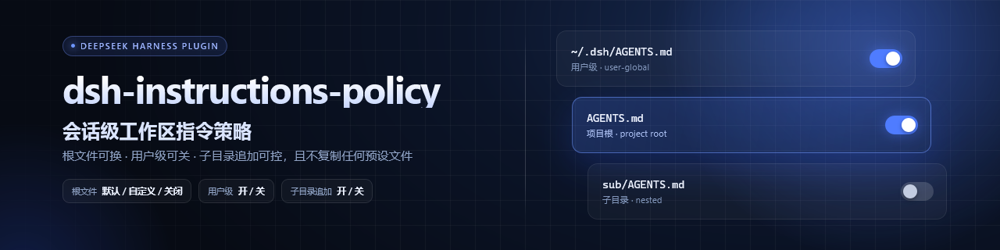

<div align="center">


# dsh-instructions-policy


[](https://www.npmjs.com/package/dsh-instructions-policy)

给 DeepSeek Harness（DSH）的工作区指令加一层**会话级策略**：根文件可换、用户级可关、子目录追加可关，且不复制任何预设文件。

**简体中文** · [English](README.en.md)

</div>

---

## 什么时候需要它

DSH 默认指令策略写死了三件事：读**项目根**的 `AGENTS.md`/`CLAUDE.md`、读**用户级** `~/.dsh/AGENTS.md` 、 `~/.agents/AGENTS.md`，以及读取子目录文件后**追加**该目录的 `AGENTS.md`。 DSH 没有提供按会话切换这些行为的入口，部分开发者（比如我）在使用AI辅助开发的时候经常会需要完全控制这套行为。在原有的机制下通常需要修改预设，但是改预设又意味着复制整份 `config.plugins`，DSH一升级就漂移。本插件因此做两件事：

1. **不碰预设**：在 Loader 的模块导入缝上把官方指令加载器整体替换成策略版，官方预设照常升级；
2. **把策略变成会话状态**：`/instructions` 命令与 Web chip 都能改，策略只从会话日志里已声明的事件回放，因此 resume、compaction、fork 都不会丢。

*注："项目根"语义遵循官方机制：从工作目录向上找到的第一个含 `.git` 的目录，找不到就用工作目录本身。*

## 实现机制

<details>
<summary>点击展开机制树</summary>

```text
profile 启动
└─ cordis.patch.yml 插入 host 行 `instructions-policy`
   ├─ src/index.ts：把 loader.internal.import 包成访问器 + Proxy（只覆写 import）
   │  └─ 任何预设 import @deepseek-ai/dsh-agent-instructions
   │     ├─ ① 先用原始 import 拿到运行版本的官方模块 → 复用 renderer
   │     │      （保证提示词格式永远与已安装的 DSH 一致）
   │     └─ ② 把本包的 lib/loader.js 交给 Loader（facade 合并 host 行 + 预设行 config）
   │        └─ 每个 agent/pre-step（下一步进入前）
   │           ├─ 折叠会话日志 surface.nodes → 模型此刻真正看到哪些指令
   │           ├─ 回放 command/run + command/done → 当前会话策略
   │           ├─ 发现文件：项目根 → cwd 链 + 用户级 + 已触碰的子目录
   │           ├─ 渲染：官方 renderer 优先、内置回退；按预算如实记录 omitted/truncated
   │           └─ 注入 agent-instructions 消息（带 changes / policy）
   │              ├─ compaction 改变 surface → baseline 下一步重建；nested 等对应目录再次触碰
   │              └─ resume 后从日志恢复 → 不重复注入
   └─ 注册 `instructionsPolicy` session projection
      └─ Web chip 通过 useProjection 读策略/锁定/最近错误/项目根/已加载文件
         └─ 命令写入走 remote.commands.execute，直接拿 handler 结果
```

因为用的是每个预设都会经过的导入缝，Standard / PTC / Creator 等预设无需改动就都会走这套策略；每一步只在 baseline identity 变化或出现 nested 增量时补发，不会重复注入。

</details> 

## 对齐与约束

本项目尽可能遵循官方插件要求开发，以下为对齐表与自身约束

<details>
<summary>点击展开约定目录</summary>

| 上游约定 | 本项目落地 |
|---|---|
| 只走官方扩展点；插件不改 agent loop | `agent/pre-step`、`tools/result`、命令服务、客户端 slot |
| 模型可见 ⟺ 会话日志 | 指令内容与策略都从会话日志重建 |
| 优先复用运行版本能力 | 复用安装版本的 instruction renderer |

**对 agent-instructions 的跟随**：预算、截断、转义和 `changes` 只记录实际渲染内容，都是对齐该包行为，不是通用插件规范。

**本项目自身约束**：零运行时依赖、不复制预设/官方 loader。

</details> 

## 使用

### Web 端

会话输入框左侧会显示「指令策略」按钮（权限控制按钮旁），点击即可显示菜单


### 命令

```text
/instructions                    显示当前策略、项目根、实际加载的文件（含已追加的子目录文件；预算排除项单独列出）
/instructions root default       恢复读取项目根
/instructions root off           跳过项目根这一层（cwd 及中间目录照读）
/instructions root custom <path> 用指定文件替代项目根这一层（相对路径先按 cwd、再按项目根解析）
/instructions global on|off      开关用户级指令
/instructions nested on|off      开关子目录追加（下一步生效）
```

子目录追加只在 `read`/`write`/`edit` 的 `file_path` 落到工作目录子树时触发（与官方一致）；shell 里的 `cd` 或列目录不会触发。

`/instructions show` 的 `files:` 是 renderer 实际带入文本的 baseline 文件，加上当前日志里已经追加的 nested 文件；被预算排除的 baseline 文件会出现在 `not loaded (budget):`，`maxBytes: 0` 时则显示 `budget: disabled`。

命令结果跟随界面语言：默认 `locale: auto` 先看 DSH 里选过的语言（设置 → 通用 → Language），没选过就用操作系统语言；也可以固定成 `zh`/`en`，插件未翻译的语言回退英文。有两处**刻意保持英文**：模型看到的指令文本（`<system-reminder>` 帧，与官方 renderer 一致），以及命令菜单里的描述与输入提示（与 DSH 自带命令一致）。

## 安装

### 前置

- 已安装并至少启动过一次 DSH（`dsh --version` 能输出版本）。
- Node.js 版本跟随 DSH：0.2.2 起要求 ≥ 24.9，0.2.1 为 `^22.19.0 || >=24.0.0`；以 DSH 的 `engines` 为准。
- `pnpm` 在 `PATH` 上：`dsh plugin` 会把参数转发给 profile 目录里的 pnpm。
- DSH `>=0.2.1-rc.5 <1.0.0-0`（0.x 全量放行；1.0 及其预发布需要重新验证）。

### 步骤

1. 把插件装进 profile（`web` 是默认 Web profile 名）：

   ```sh
   # 从 npm（推荐）
   dsh plugin --profile web add dsh-instructions-policy
   # 从 GitHub（源码安装；pnpm ≥10 的 allowBuilds 见下）
   dsh plugin --profile web add github:Angel-Hair/dsh-instructions-policy
   # 本地开发：在仓库目录执行
   dsh plugin --profile web add link:.
   ```

   安装成功后 DSH 会自动把声明了 `dsh.bundle.patch` 的依赖写入 profile 的 `dsh.profile.bundles`，不需要手工编辑 `package.json`；也可以在 Plugins 页面确认或开关。

   GitHub 源码安装会触发本包的 `prepare` 构建，pnpm ≥10 默认拦截依赖构建；首次 `add` 报 `ERR_PNPM_GIT_DEP_PREPARE_NOT_ALLOWED` 时，把提示给出的键写进 `~/.dsh/profiles/web/pnpm-workspace.yaml` 的 `allowBuilds` 后重跑，或改用 npm 安装。

2. 重启 `dsh web`，确认日志出现：

   ```
   instructions-policy: redirecting @deepseek-ai/dsh-agent-instructions for N preset row(s)
   ```

3. 打开任意新任务，输入框工具行左侧应出现「指令策略」chip；或执行 `/instructions show` 核对项目根与已加载文件。

升级后重启 `dsh web`；如果界面没有变化，再 Ctrl+F5 强制刷新。

### 升级 / 卸载

```sh
# npm / GitHub 安装：升级到最新版本（含跨 minor / major）
dsh plugin --profile web update --latest dsh-instructions-policy

# link 安装：在仓库里 git pull 后重启 dsh web 即可

# 卸载：依赖和 dsh.profile.bundles 里的条目会一起移除
dsh plugin --profile web remove dsh-instructions-policy
```

卸载后重定向消失，DSH 恢复官方默认的指令加载；已经写进会话日志的指令消息仍留在历史里。

## 可选的手工验收

如果想确认插件功能是否真的生效，可以下载 [验收夹具](https://github.com/Angel-Hair/dsh-instructions-policy/releases/latest/download/instructions-fixture.zip)，并按以下步骤测试。（插件本身不依赖这个夹具）

<details>
<summary>点击展开手工验收步骤</summary>

1. 解压到一个独立目录。（父目录里不含有任意如 `.git`、`AGENTS.md` 等干扰测试的文件）
2. DSH 新建工作区选解压出来的 `/instructions-fixture` 下的 `/sub` 目录。
3. 参考下面给出的样本给**该工作区的AI会话**发送指令，或者按包内 `VERIFY.md` 执行 A–F 场景。（**建议思考强度设置为Low/High，以免造成不必要的开销**）

参考指令：

> 本会话用于测试 `dsh-instructions-policy` 插件，目前为初始会话。当前设置为[开启/关闭根文件/自定义根文件]，[开启/关闭]用户级根文件，[开启/关闭]子目录追加。你确认下状态对不对。（注意！你只需要汇报状况，不需要完全理解插件原理）

</details>

## 配置

<details>
<summary>点击展开配置说明</summary>

默认值见 [cordis.patch.yml](cordis.patch.yml)。要改默认值，在 `~/.dsh/profiles/web/cordis.patch.yml`（其他 profile 换成对应目录）里按 `id` 覆盖；**DSH 按行整行替换 `config`，不做深合并**，所以覆盖时要重述所有需要的字段：

```yaml
- id: instructions-policy
  config:
    maxBytes: 16384
    maxSourceBytes: 1048576
    locale: auto
    projectRootMarkers: ['.git']
    candidates: ['AGENTS.md', 'CLAUDE.md']
    localCandidates: ['AGENTS.local.md', 'CLAUDE.local.md']
    policy:
      root: default
      file: null
      global: true
      nested: true
```

| 字段 | 默认 | 说明 |
|---|---|---|
| `policy.root` | `default` | `default` 读项目根候选；`off` 跳过这一层；`custom` 用 `policy.file` 替代这一层 |
| `policy.file` | `null` | 自定义根文件；Web chip 的「自定义文件」导入附件时写入附件引用，也可用 `/instructions root custom <path>` 填路径 |
| `policy.global` | `true` | 是否读 `~/.dsh/AGENTS.md` 与 `~/.agents/AGENTS.md`（`$DSH_HOME` / `$DSH_AGENTS_HOME` 可覆盖，界面显示为对应变量名） |
| `policy.nested` | `true` | 是否在读取子目录文件后追加该目录的指令 |
| `locale` | `auto` | `/instructions` 结果的输出语言：`auto` 先跟随 DSH 里选过的语言、再跟随系统语言；`zh`/`en` 固定；未翻译的语言回退英文 |
| `maxBytes` | `65536` | 指令消息的字节预算；官方 renderer 按 user-global / project 两条链各算一份（合并帧最多 2×），内置回退按整条消息算；`0` 关闭指令加载 |
| `maxSourceBytes` | `1048576` | 单个指令文件的读取上限，超限视为不存在 |
| `projectRootMarkers` | `['.git']` | 向上查找项目根时匹配的目录项 |
| `candidates` | `['AGENTS.md', 'CLAUDE.md']` | 每个目录先读的基础候选 |
| `localCandidates` | `['AGENTS.local.md', 'CLAUDE.local.md']` | 基础候选之后读的本地覆盖 |

`maxSourceBytes`、`projectRootMarkers`、`candidates`、`localCandidates` 是高级字段，通常不需要改。

</details>

## 兼容性与已知限制

- 本插件替换官方 loader；正常单插件运行不冲突，但不要在同一个会话里同时挂官方 loader，两套 baseline/nested 状态会互相替换。
- 本插件的 `changes.scope` 是 displayPath，官方是 per-candidate key；卸载或换到无插件 profile 后，官方读取旧消息可能重复或错分类，建议新开会话或先压缩一次。
- 依赖 `ctx.loader.internal`（非文档化导入缝）。上游改名或换实现时，`apply` 阶段与首个 pre-step 的自检会 warn `policy inactive`，策略退回官方默认行为，不会静默改坏 prompt。
- `engines.dsh` 只拦 1.0（含 1.0 预发布）：0.x 的次要升级放行；出问题时先看 `redirecting …` 日志与 `policy inactive` 自检。

## 反馈问题

<details>
<summary>点击展开反馈约定</summary>

本插件没有引入日志系统：它保持零运行时依赖、不写任何文件，诊断信息都通过 DSH 的 logger 输出到启动 `dsh web` 的终端（Cordis 的 console logger）。`~/.dsh` 下没有日志目录，会话 JSONL 也只记录会话事件、不含 logger 输出，所以反馈时需要的"日志"就是那段终端输出。

提 issue 时请附上：

- DSH 版本（`dsh --version`）、插件版本（profile 的 `package.json` 或 `node_modules/dsh-instructions-policy/package.json`）、操作系统。
- profile 的 `dsh.profile.bundles`，以及 `~/.dsh/profiles/web/cordis.patch.yml`（按实际 profile 替换 `web`）里与本插件相关的行。
- 启动 `dsh web` 的终端输出中所有含 `instructions-policy` 的行（`redirecting …`、`policy inactive`、`compose failed` 等）。看不到终端时先重定向再复现：

  ```powershell
  dsh web *> dsh.log        # PowerShell
  # dsh web > dsh.log 2>&1  # cmd / bash
  ```

- `/instructions show` 的完整输出（含项目根与实际加载的文件）。
- 最小复现步骤、预期结果与实际结果；涉及私有路径或仓库名请先脱敏。

反馈标准：**能复现**（有步骤）、**有版本**（DSH + 插件 + OS）、**有输出**（终端日志 + `/instructions show`）、**有差异**（预期 vs 实际）。

</details>

## 许可

本项目以 [Mozilla Public License 2.0](LICENSE) 授权；版权信息与 Exhibit A 声明见 [NOTICE](NOTICE)。

Copyright (c) 2026 dsh-instructions-policy contributors.
